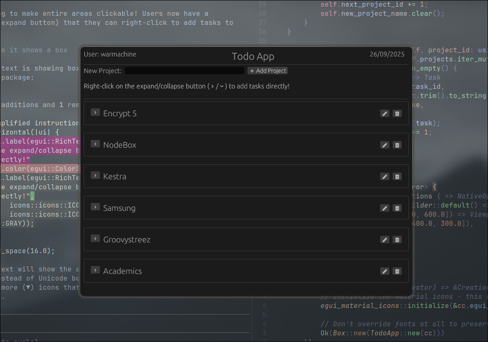
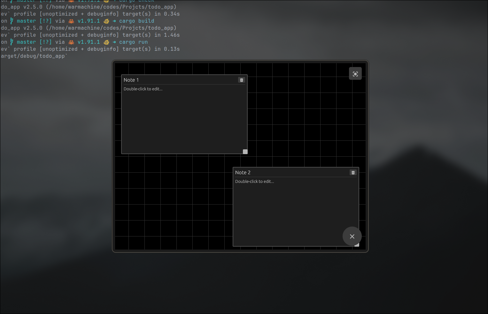

<h1 align="center" style="color:red" > RUST::TODO<&APP> </h1>

---
<h4 align="center"> This is all your todo app should do. </h4>





A small desktop app for projects, tasks and a freeform notes canvas, built with
`eframe` / `egui`. It installs like a normal application, lives in the system
tray, and is one keystroke away from anywhere.

## Install

Grab the artifact for your platform from the
[latest release](https://github.com/thearpankumar/RustTodoApp/releases).

### Windows

Run the `.msi`. It installs to `Program Files\Todo App\bin`, adds a **Start menu**
entry (so Windows Search finds it), optionally a desktop shortcut, and registers
the app in Add/Remove Programs. `Win+R -> todo_app` works too.

A portable `.zip` with just the `.exe` is also published.

### Linux

| Artifact | Install |
|---|---|
| `.deb` | `sudo apt install ./todo-app_<version>_amd64.deb` |
| `.rpm` | `sudo dnf install ./todo_app-<version>.x86_64.rpm` |
| `.AppImage` | `chmod +x todo_app-*.AppImage && ./todo_app-*.AppImage` |

The packages install the binary as `/usr/bin/todo_app`, a desktop entry, and the
icon in every `hicolor` size, so the app shows up in your launcher with its icon.

### macOS

Open the `.dmg` and drag **Todo App** to Applications. The build is universal
(Apple Silicon and Intel) but **not code-signed**, so the first launch needs
right-click -> *Open* -> *Open* to get past Gatekeeper.

## Using it

### The global hotkey

Press <kbd>Ctrl</kbd>+<kbd>Shift</kbd>+<kbd>:</kbd> anywhere to show the window,
and again to hide it. Closing the window hides it to the tray rather than
quitting - the app has to keep running for the hotkey to work.

The tray icon has **Show / hide**, **Start at login** and **Quit**. Start at
login is on after a fresh install; turn it off from that menu.

Launching the app again while it is running does not start a second copy, it
just brings the window back. The same commands are available from a terminal:

```bash
todo_app --toggle      # show if hidden, hide if shown
todo_app --show        # show and focus
todo_app --hide        # hide to the tray
todo_app --quit        # quit the running instance
todo_app --background  # start into the tray without showing the window
```

### Wayland

Wayland compositors do not let applications grab keys - the compositor owns
them - so the built-in hotkey only works on X11, Windows and macOS. On Wayland,
register the shortcut with your desktop environment instead:

```bash
scripts/install-hotkey-linux.sh
```

It handles GNOME, Hyprland and sway automatically. For anything else, add a
custom shortcut for <kbd>Ctrl</kbd>+<kbd>Shift</kbd>+<kbd>:</kbd> running
`todo_app --toggle`. The app tells you in its own window when it could not grab
the hotkey itself.

### Hyprland

The window's `app_id` is `todo_app`, so these rules match:

```conf
windowrulev2 = float, class:^(todo_app)$
windowrulev2 = size 800 600, class:^(todo_app)$
windowrulev2 = center, class:^(todo_app)$
```

### Where your data lives

Release builds use the platform's standard location:

| Platform | Path |
|---|---|
| Windows | `%APPDATA%\todo_app\data\app.ron` |
| Linux | `~/.local/share/todo_app/app.ron` |
| macOS | `~/Library/Application Support/todo_app/app.ron` |

Data written by versions before 2.6 lived under the app's display name instead;
it is copied across automatically the first time the new version starts.

Debug builds keep their data in `todo_data.json` in the working directory, so
development never touches your real list.

## Building from source

```bash
cargo build --release
```

On Linux the system tray needs GTK and libappindicator at build time:

```bash
sudo apt install libgtk-3-dev libxdo-dev libayatana-appindicator3-dev
```

Two workspace tasks are wired up as cargo aliases:

```bash
cargo ci      # cargo fmt --check, clippy -D warnings, cargo check
cargo icons   # regenerate every packaging icon from assets/logo.svg
```

`cargo icons` is the only way icons should be produced. It renders
`assets/logo.svg` into the `hicolor` PNG sizes, the multi-resolution Windows
`.ico`, and the macOS `.icns`, so no platform's icon can drift from the others.

Packaging inputs are committed rather than generated in CI:

- `wix/main.wxs` - the Windows installer. Do **not** run `cargo wix init`; it
  overwrites this file with a template that has no Start menu shortcut.
- `packaging/linux/todo_app.desktop` - the Linux desktop entry.
- `packaging/macos/Info.plist` - the macOS bundle manifest.
